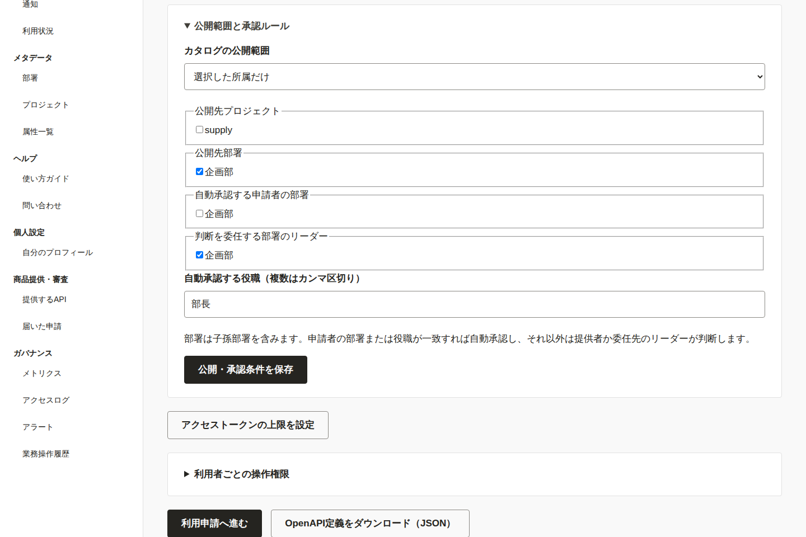

# 提供者は、商品の利用対象を限定するとき、公開範囲を設定できる

判定　合格

対象コミット　`44976472fbf53461052e4e879e7f140efc8ae599`

[検証した要件と変更履歴](https://github.com/tsuji-tomonori/tsugite-api/blob/44976472fbf53461052e4e879e7f140efc8ae599/docs/requirements/items/%E6%8F%90%E4%BE%9B%E8%80%85%E3%81%AF%E3%80%81%E5%95%86%E5%93%81%E3%81%AE%E5%88%A9%E7%94%A8%E5%AF%BE%E8%B1%A1%E3%82%92%E9%99%90%E5%AE%9A%E3%81%99%E3%82%8B%E3%81%A8%E3%81%8D%E3%80%81%E5%85%AC%E9%96%8B%E7%AF%84%E5%9B%B2%E3%82%92%E8%A8%AD%E5%AE%9A%E3%81%A7%E3%81%8D%E3%82%8B.md)

## 実行したテストと証跡

- 成功　提供者が公開・自動承認・委任の条件を保存し、部署リーダーが個人申請を画面から却下する（14.122 秒）　`tests/e2e/browser/test_delegation_console.py::test_provider_policy_console`
  - 
- 成功　公開範囲、委任判断、個人・プロジェクト別申請、部署・役職の自動承認を確認する（0.636 秒）　`packages/backend/tests/test_org_access.py::test_delegation_search_and_personal_isolation`
- 成功　限定公開の任意属性条件を移管時に引き継ぎ、所属を解除すると閲覧できなくなる。（0.288 秒）　`packages/backend/tests/test_user_metadata.py::test_metadata_audience_and_transfer`

[テスト実行記録（JUnit XML）](%E6%8F%90%E4%BE%9B%E8%80%85%E3%81%AF%E3%80%81%E5%95%86%E5%93%81%E3%81%AE%E5%88%A9%E7%94%A8%E5%AF%BE%E8%B1%A1%E3%82%92%E9%99%90%E5%AE%9A%E3%81%99%E3%82%8B%E3%81%A8%E3%81%8D%E3%80%81%E5%85%AC%E9%96%8B%E7%AF%84%E5%9B%B2%E3%82%92%E8%A8%AD%E5%AE%9A%E3%81%A7%E3%81%8D%E3%82%8B.xml)
