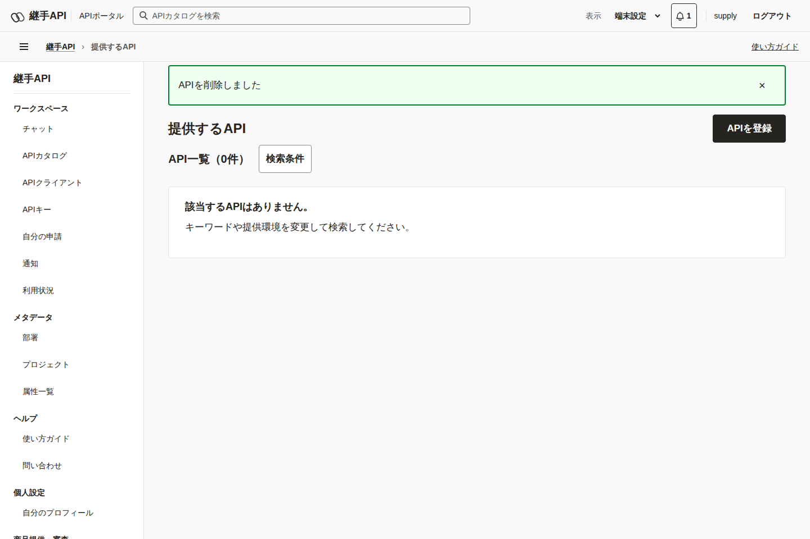

# 提供者は、商品の提供を終了するとき、商品を削除できる

判定　合格

対象コミット　`7cad9c4bc476d8d01f322dba83ac9f6c975bcd4d`

[検証した要件と変更履歴](https://github.com/tsuji-tomonori/tsugite-api/blob/7cad9c4bc476d8d01f322dba83ac9f6c975bcd4d/docs/requirements/items/%E6%8F%90%E4%BE%9B%E8%80%85%E3%81%AF%E3%80%81%E5%95%86%E5%93%81%E3%81%AE%E6%8F%90%E4%BE%9B%E3%82%92%E7%B5%82%E4%BA%86%E3%81%99%E3%82%8B%E3%81%A8%E3%81%8D%E3%80%81%E5%95%86%E5%93%81%E3%82%92%E5%89%8A%E9%99%A4%E3%81%A7%E3%81%8D%E3%82%8B.md)

## 実行したテストと証跡

- 成功　3役で利用状況、ユーザー管理、名称で選んだ宛先への通知、ログ保存、掲載終了を確認する。（15.541 秒）　`tests/e2e/browser/test_portal.py::test_governance_console`
  - 
- 成功　掲載内容の修正と仕様の変更を区別し、競合を検知し、削除後も監査を保持する（0.363 秒）　`packages/backend/tests/test_governance.py::test_listing_revisions`
- 成功　名称変更では利用権を保持し、構造変更・削除では公開と既存の権利を終了する。（形式仕様の操作と期待状態を照合する。）（0.280 秒）　`packages/backend/tests/test_quint_grants.py::test_product_history[products.deleteTest]`
- 成功　名称変更では利用権を保持し、構造変更・削除では公開と既存の権利を終了する。（形式仕様の操作と期待状態を照合する。）（0.601 秒）　`packages/backend/tests/test_quint_grants.py::test_product_history[products.editTest]`
- 成功　名称変更では利用権を保持し、構造変更・削除では公開と既存の権利を終了する。（形式仕様の操作と期待状態を照合する。）（0.275 秒）　`packages/backend/tests/test_quint_grants.py::test_product_history[products.pendingEditTest]`

[テスト実行記録（JUnit XML）](%E6%8F%90%E4%BE%9B%E8%80%85%E3%81%AF%E3%80%81%E5%95%86%E5%93%81%E3%81%AE%E6%8F%90%E4%BE%9B%E3%82%92%E7%B5%82%E4%BA%86%E3%81%99%E3%82%8B%E3%81%A8%E3%81%8D%E3%80%81%E5%95%86%E5%93%81%E3%82%92%E5%89%8A%E9%99%A4%E3%81%A7%E3%81%8D%E3%82%8B.xml)
