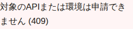

# 提供者は、商品の新規受付を終えるとき、掲載を停止できる

判定　合格

対象コミット　`a8ce7bc1f7c63cce6c1b5f352626ae1b791f7a85`

## 実行したテストと証跡

- 成功　デモの提供者と利用者が公開・申請・承認・実行・権限取消を画面で完了できる（13.552 秒）　`tests/e2e/browser/test_portal.py::test_user_flow`
  - 

[テスト実行記録（JUnit XML）](%E6%8F%90%E4%BE%9B%E8%80%85%E3%81%AF%E3%80%81%E5%95%86%E5%93%81%E3%81%AE%E6%96%B0%E8%A6%8F%E5%8F%97%E4%BB%98%E3%82%92%E7%B5%82%E3%81%88%E3%82%8B%E3%81%A8%E3%81%8D%E3%80%81%E6%8E%B2%E8%BC%89%E3%82%92%E5%81%9C%E6%AD%A2%E3%81%A7%E3%81%8D%E3%82%8B.xml)
