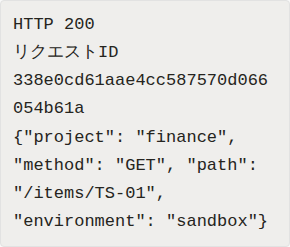

# 提供者は、商品を登録するとき、API識別名を指定できる

判定　合格

対象コミット　`6f47997508f5b067db9632c3a425ced87ee8955a`

## 実行したテストと証跡

- 成功　API識別名が必須かつ一意で、登録後に変更や再利用ができない。（0.267 秒）　`packages/backend/tests/test_catalog.py::test_api_slug_is_unique_and_fixed`
- 成功　既存商品に識別名を加えても利用権が残り、識別名と従来のUUIDで同じAPIを呼べる。（0.208 秒）　`packages/backend/tests/test_catalog.py::test_existing_api_keeps_grants_when_named`
- 成功　デモの提供者と利用者が公開・申請・承認・実行・権限取消を画面で完了できる（9.302 秒）　`tests/e2e/browser/test_portal.py::test_user_flow`
  - 

[テスト実行記録（JUnit XML）](%E6%8F%90%E4%BE%9B%E8%80%85%E3%81%AF%E3%80%81%E5%95%86%E5%93%81%E3%82%92%E7%99%BB%E9%8C%B2%E3%81%99%E3%82%8B%E3%81%A8%E3%81%8D%E3%80%81API%E8%AD%98%E5%88%A5%E5%90%8D%E3%82%92%E6%8C%87%E5%AE%9A%E3%81%A7%E3%81%8D%E3%82%8B.xml)
