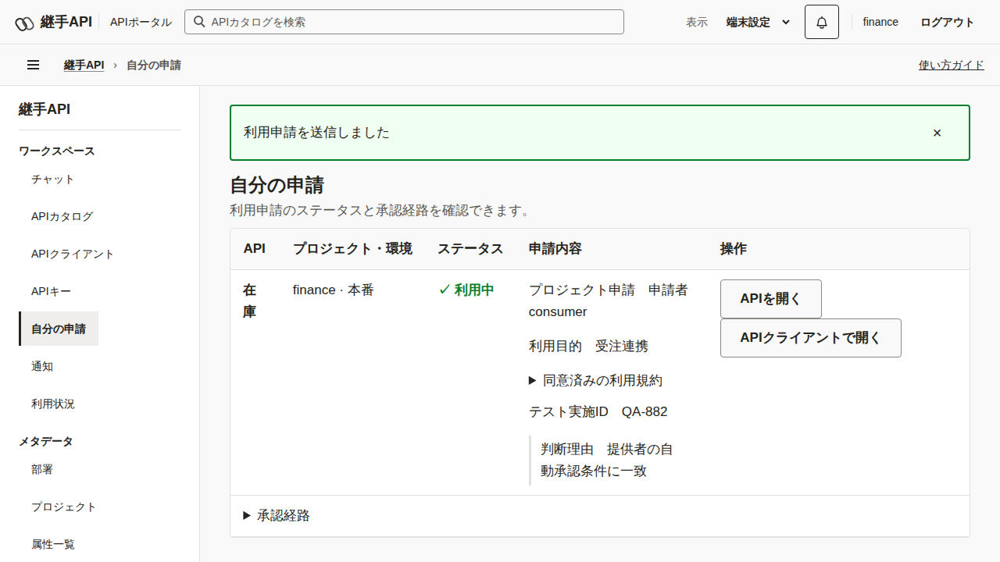

# 提供者は、環境に応じて申請を受け付けるとき、利用条件を設定できる

判定　合格

対象コミット　`fd4d5eb6fc4dd6e00ea5cd44a6a40c2fa7fc077a`

[検証した要件と変更履歴](https://github.com/tsuji-tomonori/tsugite-api/blob/fd4d5eb6fc4dd6e00ea5cd44a6a40c2fa7fc077a/docs/requirements/items/%E6%8F%90%E4%BE%9B%E8%80%85%E3%81%AF%E3%80%81%E7%92%B0%E5%A2%83%E3%81%AB%E5%BF%9C%E3%81%98%E3%81%A6%E7%94%B3%E8%AB%8B%E3%82%92%E5%8F%97%E3%81%91%E4%BB%98%E3%81%91%E3%82%8B%E3%81%A8%E3%81%8D%E3%80%81%E5%88%A9%E7%94%A8%E6%9D%A1%E4%BB%B6%E3%82%92%E8%A8%AD%E5%AE%9A%E3%81%A7%E3%81%8D%E3%82%8B.md)

## 実行したテストと証跡

- 成功　商品を公開し、利用者が商品詳細から利用申請できる（8.149 秒）　`tests/e2e/browser/test_product_publication.py::test_publish_and_apply_from_product_page`
  - 
- 成功　環境別の承認条件を守り、複数の承認を指定の順序で行う（2.809 秒）　`packages/backend/tests/test_product_offers.py::test_three_environments_and_ordered_reviews`
- 成功　所属属性が一致した場合の自動承認と、環境別の自動承認でも必要な規約同意を照合する。（形式仕様の操作と期待状態を照合する。）（1.296 秒）　`packages/backend/tests/test_quint_grants.py::test_automatic_decisions[automatic.autoTest]`
- 成功　利用条件と部署・提供者の承認順を再生し、最終判断まで呼び出しを拒否する。（形式仕様の操作と期待状態を照合する。）（0.696 秒）　`packages/backend/tests/test_quint_grants.py::test_ordered_history[review.orderedTest]`
- 成功　利用条件と部署・提供者の承認順を再生し、最終判断まで呼び出しを拒否する。（形式仕様の操作と期待状態を照合する。）（1.098 秒）　`packages/backend/tests/test_quint_grants.py::test_ordered_history[review.termsTest]`

[テスト実行記録（JUnit XML）](%E6%8F%90%E4%BE%9B%E8%80%85%E3%81%AF%E3%80%81%E7%92%B0%E5%A2%83%E3%81%AB%E5%BF%9C%E3%81%98%E3%81%A6%E7%94%B3%E8%AB%8B%E3%82%92%E5%8F%97%E3%81%91%E4%BB%98%E3%81%91%E3%82%8B%E3%81%A8%E3%81%8D%E3%80%81%E5%88%A9%E7%94%A8%E6%9D%A1%E4%BB%B6%E3%82%92%E8%A8%AD%E5%AE%9A%E3%81%A7%E3%81%8D%E3%82%8B.xml)
