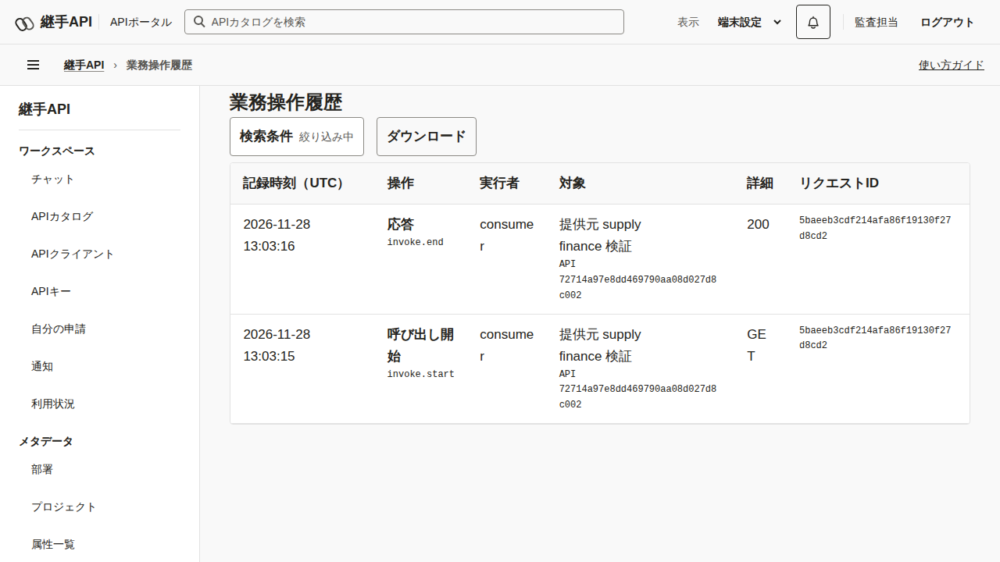

# 監査担当は、APIの利用経緯を調べるとき、業務監査とアクセスログを照合できる

判定　合格

対象コミット　`d9f31e9b0159ab947c37778704413fe3714d504a`

[検証した要件と変更履歴](https://github.com/tsuji-tomonori/tsugite-api/blob/d9f31e9b0159ab947c37778704413fe3714d504a/docs/requirements/items/%E7%9B%A3%E6%9F%BB%E6%8B%85%E5%BD%93%E3%81%AF%E3%80%81API%E3%81%AE%E5%88%A9%E7%94%A8%E7%B5%8C%E7%B7%AF%E3%82%92%E8%AA%BF%E3%81%B9%E3%82%8B%E3%81%A8%E3%81%8D%E3%80%81%E6%A5%AD%E5%8B%99%E7%9B%A3%E6%9F%BB%E3%81%A8%E3%82%A2%E3%82%AF%E3%82%BB%E3%82%B9%E3%83%AD%E3%82%B0%E3%82%92%E7%85%A7%E5%90%88%E3%81%A7%E3%81%8D%E3%82%8B.md)

## 実行したテストと証跡

- 成功　監査担当が他の利用者のアクセスと業務監査を同じIDで照合し、両方の記録を保存できる。（7.324 秒）　`tests/e2e/browser/test_requirement_flows.py::test_auditor_cross_checks_exports`
  - 
- 成功　承認した呼び出しを接続先へ転送し、権限取消後は遮断する（検証環境の在庫を照会する）（2.452 秒）　`tests/e2e/aws/test_portal.py::test_approved_calls_reach_upstream[cognito-lambda-staging]`
- 成功　承認した呼び出しを接続先へ転送し、権限取消後は遮断する（本番環境の在庫を照会する）（2.295 秒）　`tests/e2e/aws/test_portal.py::test_approved_calls_reach_upstream[cognito-lambda-production]`
- 成功　承認した呼び出しを接続先へ転送し、権限取消後は遮断する（利用者がLambdaへ接続する）（2.168 秒）　`tests/e2e/aws/test_portal.py::test_approved_calls_reach_upstream[cognito-lambda]`
- 成功　承認した呼び出しを接続先へ転送し、権限取消後は遮断する（システムがLambdaへ接続する）（2.121 秒）　`tests/e2e/aws/test_portal.py::test_approved_calls_reach_upstream[machine-lambda]`
- 成功　承認した呼び出しを接続先へ転送し、権限取消後は遮断する（利用者がHTTPS先へ接続する）（2.546 秒）　`tests/e2e/aws/test_portal.py::test_approved_calls_reach_upstream[cognito-https]`
- 成功　同じ所属でも本人の履歴を分離し、配下の監査・絞り込み・出力と権限解除を検証する。（0.516 秒）　`packages/backend/tests/test_org_access.py::test_access_log_scopes`
- 成功　監査の役割と呼出時の帰属に従い、本人画面と監査画面の詳細を照合する。（形式仕様の操作と期待状態を照合する。）（0.287 秒）　`packages/backend/tests/test_quint_governance.py::test_log_history[audit.auditLogTest]`
- 成功　監査の役割と呼出時の帰属に従い、本人画面と監査画面の詳細を照合する。（形式仕様の操作と期待状態を照合する。）（0.285 秒）　`packages/backend/tests/test_quint_governance.py::test_log_history[audit.personalLogTest]`

[テスト実行記録（JUnit XML）](%E7%9B%A3%E6%9F%BB%E6%8B%85%E5%BD%93%E3%81%AF%E3%80%81API%E3%81%AE%E5%88%A9%E7%94%A8%E7%B5%8C%E7%B7%AF%E3%82%92%E8%AA%BF%E3%81%B9%E3%82%8B%E3%81%A8%E3%81%8D%E3%80%81%E6%A5%AD%E5%8B%99%E7%9B%A3%E6%9F%BB%E3%81%A8%E3%82%A2%E3%82%AF%E3%82%BB%E3%82%B9%E3%83%AD%E3%82%B0%E3%82%92%E7%85%A7%E5%90%88%E3%81%A7%E3%81%8D%E3%82%8B.xml)
