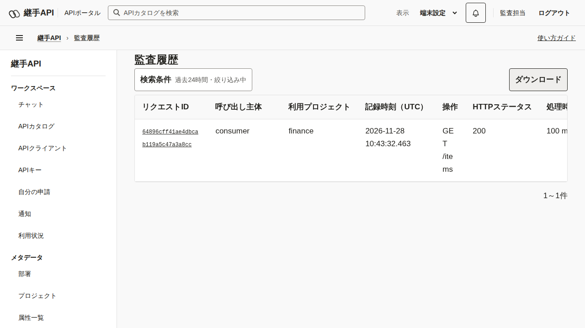

# 監査担当は、業務監査の記録を保存するとき、アクセスログと業務監査をダウンロードできる

判定　合格

対象コミット　`8bcf0cc6240ee08bf76bd673d1c7a3e9d6f45d9b`

[検証した要件と変更履歴](https://github.com/tsuji-tomonori/tsugite-api/blob/8bcf0cc6240ee08bf76bd673d1c7a3e9d6f45d9b/docs/requirements/items/%E7%9B%A3%E6%9F%BB%E6%8B%85%E5%BD%93%E3%81%AF%E3%80%81%E6%A5%AD%E5%8B%99%E7%9B%A3%E6%9F%BB%E3%81%AE%E8%A8%98%E9%8C%B2%E3%82%92%E4%BF%9D%E5%AD%98%E3%81%99%E3%82%8B%E3%81%A8%E3%81%8D%E3%80%81%E3%82%A2%E3%82%AF%E3%82%BB%E3%82%B9%E3%83%AD%E3%82%B0%E3%81%A8%E6%A5%AD%E5%8B%99%E7%9B%A3%E6%9F%BB%E3%82%92%E3%83%80%E3%82%A6%E3%83%B3%E3%83%AD%E3%83%BC%E3%83%89%E3%81%A7%E3%81%8D%E3%82%8B.md)

## 実行したテストと証跡

- 成功　監査担当が他の利用者のアクセスと業務監査を同じIDで照合し、両方の記録を保存できる。（6.246 秒）　`tests/e2e/browser/test_requirement_flows.py::test_auditor_cross_checks_exports`
  - 
- 成功　同じ時刻の251件を複数ページに分けて全件取得し、重複・欠落と時差を確認する（0.186 秒）　`packages/backend/tests/test_governance.py::test_log_download_pages`
- 成功　同じ所属でも本人の履歴を分離し、配下の監査・絞り込み・出力と権限解除を検証する。（0.492 秒）　`packages/backend/tests/test_org_access.py::test_access_log_scopes`
- 成功　監査の役割と呼出時の帰属に従い、本人画面と監査画面の詳細を照合する。（形式仕様の操作と期待状態を照合する。）（0.286 秒）　`packages/backend/tests/test_quint_governance.py::test_log_history[audit.auditLogTest]`
- 成功　監査の役割と呼出時の帰属に従い、本人画面と監査画面の詳細を照合する。（形式仕様の操作と期待状態を照合する。）（0.267 秒）　`packages/backend/tests/test_quint_governance.py::test_log_history[audit.personalLogTest]`

[テスト実行記録（JUnit XML）](%E7%9B%A3%E6%9F%BB%E6%8B%85%E5%BD%93%E3%81%AF%E3%80%81%E6%A5%AD%E5%8B%99%E7%9B%A3%E6%9F%BB%E3%81%AE%E8%A8%98%E9%8C%B2%E3%82%92%E4%BF%9D%E5%AD%98%E3%81%99%E3%82%8B%E3%81%A8%E3%81%8D%E3%80%81%E3%82%A2%E3%82%AF%E3%82%BB%E3%82%B9%E3%83%AD%E3%82%B0%E3%81%A8%E6%A5%AD%E5%8B%99%E7%9B%A3%E6%9F%BB%E3%82%92%E3%83%80%E3%82%A6%E3%83%B3%E3%83%AD%E3%83%BC%E3%83%89%E3%81%A7%E3%81%8D%E3%82%8B.xml)
