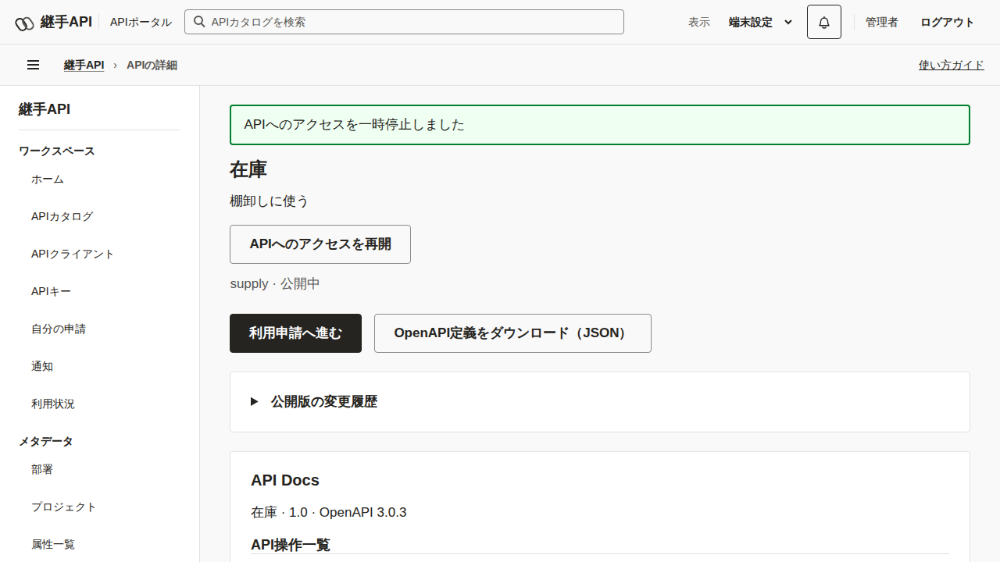

# 管理者は、APIへの不正アクセスを検知したとき、対象のAPIへのアクセスを一時停止できる

判定　合格

対象コミット　`e77afc4a3eda88a0cba4fd2035ecaa9b1cd3bd8c`

[検証した要件と変更履歴](https://github.com/tsuji-tomonori/tsugite-api/blob/e77afc4a3eda88a0cba4fd2035ecaa9b1cd3bd8c/docs/requirements/items/%E7%AE%A1%E7%90%86%E8%80%85%E3%81%AF%E3%80%81API%E3%81%B8%E3%81%AE%E4%B8%8D%E6%AD%A3%E3%82%A2%E3%82%AF%E3%82%BB%E3%82%B9%E3%82%92%E6%A4%9C%E7%9F%A5%E3%81%97%E3%81%9F%E3%81%A8%E3%81%8D%E3%80%81%E5%AF%BE%E8%B1%A1%E3%81%AEAPI%E3%81%B8%E3%81%AE%E3%82%A2%E3%82%AF%E3%82%BB%E3%82%B9%E3%82%92%E4%B8%80%E6%99%82%E5%81%9C%E6%AD%A2%E3%81%A7%E3%81%8D%E3%82%8B.md)

## 実行したテストと証跡

- 成功　拒否を記録した対象APIを管理者が一時停止し、許可済みの呼び出しだけを対象別に止められる。（5.056 秒）　`tests/e2e/browser/test_requirement_flows.py::test_admin_stops_target_after_denial`
  - 
- 成功　承認した環境だけで呼び出せ、取消後の拒否を監査できる（0.386 秒）　`packages/backend/tests/test_catalog.py::test_lifecycle`
- 成功　本人、別人、共有キーとマシンの権利を区別し、停止・失効を即時反映する。（形式仕様の操作と期待状態を照合する。）（0.001 秒）　`packages/backend/tests/test_quint_policy.py::test_entitlement_policy[entitlement.principalTest]`
- 成功　本人、別人、共有キーとマシンの権利を区別し、停止・失効を即時反映する。（形式仕様の操作と期待状態を照合する。）（0.001 秒）　`packages/backend/tests/test_quint_policy.py::test_entitlement_policy[entitlement.stopTest]`

[テスト実行記録（JUnit XML）](%E7%AE%A1%E7%90%86%E8%80%85%E3%81%AF%E3%80%81API%E3%81%B8%E3%81%AE%E4%B8%8D%E6%AD%A3%E3%82%A2%E3%82%AF%E3%82%BB%E3%82%B9%E3%82%92%E6%A4%9C%E7%9F%A5%E3%81%97%E3%81%9F%E3%81%A8%E3%81%8D%E3%80%81%E5%AF%BE%E8%B1%A1%E3%81%AEAPI%E3%81%B8%E3%81%AE%E3%82%A2%E3%82%AF%E3%82%BB%E3%82%B9%E3%82%92%E4%B8%80%E6%99%82%E5%81%9C%E6%AD%A2%E3%81%A7%E3%81%8D%E3%82%8B.xml)
