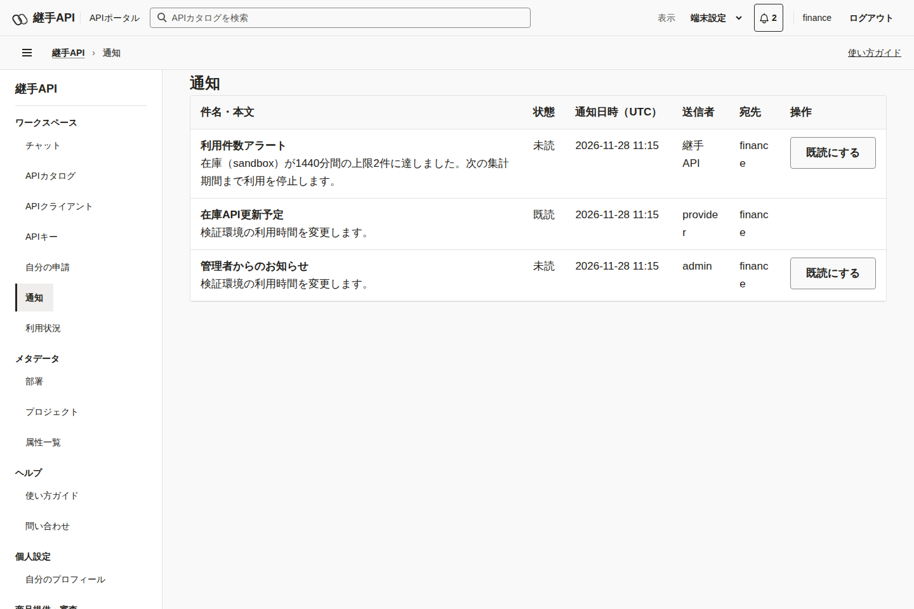

# 管理者は、利用者に周知するとき、通知を配信できる

判定　合格

対象コミット　`e21e4aff8342a5da99913ad71bfae714b8979534`

[検証した要件と変更履歴](https://github.com/tsuji-tomonori/tsugite-api/blob/e21e4aff8342a5da99913ad71bfae714b8979534/docs/requirements/items/%E7%AE%A1%E7%90%86%E8%80%85%E3%81%AF%E3%80%81%E5%88%A9%E7%94%A8%E8%80%85%E3%81%AB%E5%91%A8%E7%9F%A5%E3%81%99%E3%82%8B%E3%81%A8%E3%81%8D%E3%80%81%E9%80%9A%E7%9F%A5%E3%82%92%E9%85%8D%E4%BF%A1%E3%81%A7%E3%81%8D%E3%82%8B.md)

## 実行したテストと証跡

- 成功　3役で利用状況、ユーザー管理、名称で選んだ宛先への通知、ログ保存、掲載終了を確認する。（16.069 秒）　`tests/e2e/browser/test_portal.py::test_governance_console`
  - 
- 成功　管理者と提供者の通知先には登録された名称を表示し、送信には識別子を使う。（0.006 秒）　`packages/frontend/tests/test_notification_recipients.py::test_notification_recipient_dropdown_uses_display_names`
- 成功　受信者ごとの未読数と、同じ通知を再度開いたときの件数を照合する。（形式仕様の操作と期待状態を照合する。）（0.177 秒）　`packages/backend/tests/test_quint_governance.py::test_read_history[notifications.readTest]`
- 成功　同じ所属先の二人が通知を受け、一人が複数回開いても既読件数は本人の一件分だけ変わる。（0.481 秒）　`packages/backend/tests/test_required_messages.py::test_independent_notification_counts`

[テスト実行記録（JUnit XML）](%E7%AE%A1%E7%90%86%E8%80%85%E3%81%AF%E3%80%81%E5%88%A9%E7%94%A8%E8%80%85%E3%81%AB%E5%91%A8%E7%9F%A5%E3%81%99%E3%82%8B%E3%81%A8%E3%81%8D%E3%80%81%E9%80%9A%E7%9F%A5%E3%82%92%E9%85%8D%E4%BF%A1%E3%81%A7%E3%81%8D%E3%82%8B.xml)
