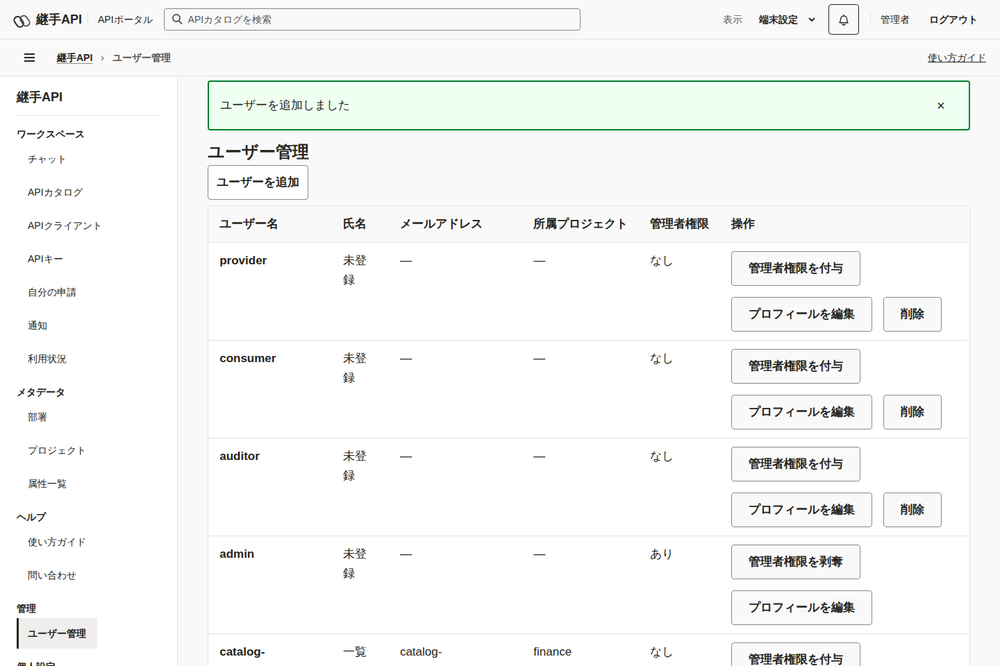

# 管理者は、利用者の在籍状況が変わったとき、利用者を追加または削除できる

判定　合格

対象コミット　`3f236ef119c9f98eded43090ae3f5e98464527df`

[検証した要件と変更履歴](https://github.com/tsuji-tomonori/tsugite-api/blob/3f236ef119c9f98eded43090ae3f5e98464527df/docs/requirements/items/%E7%AE%A1%E7%90%86%E8%80%85%E3%81%AF%E3%80%81%E5%88%A9%E7%94%A8%E8%80%85%E3%81%AE%E5%9C%A8%E7%B1%8D%E7%8A%B6%E6%B3%81%E3%81%8C%E5%A4%89%E3%82%8F%E3%81%A3%E3%81%9F%E3%81%A8%E3%81%8D%E3%80%81%E5%88%A9%E7%94%A8%E8%80%85%E3%82%92%E8%BF%BD%E5%8A%A0%E3%81%BE%E3%81%9F%E3%81%AF%E5%89%8A%E9%99%A4%E3%81%A7%E3%81%8D%E3%82%8B.md)

## 実行したテストと証跡

- 成功　3役で利用状況、ユーザー管理、名称で選んだ宛先への通知、ログ保存、掲載終了を確認する。（17.579 秒）　`tests/e2e/browser/test_portal.py::test_governance_console`
  - 
- 成功　AWS Emulatorで氏名付き招待と本人編集を行い、Cognitoの識別子とトークンが継続して使える。（2.159 秒）　`tests/e2e/aws/test_portal.py::test_cognito_member_lifecycle`
- 成功　招待時の氏名・表示名は所属一覧に載り、管理者による変更と退会は対象者に反映される。（利用者として招待して会員一覧に反映する）（0.250 秒）　`packages/backend/tests/test_required_people.py::test_invitation_profile_and_retirement[consumer]`
- 成功　招待時の氏名・表示名は所属一覧に載り、管理者による変更と退会は対象者に反映される。（提供者として招待して会員一覧に反映する）（0.256 秒）　`packages/backend/tests/test_required_people.py::test_invitation_profile_and_retirement[provider]`

[テスト実行記録（JUnit XML）](%E7%AE%A1%E7%90%86%E8%80%85%E3%81%AF%E3%80%81%E5%88%A9%E7%94%A8%E8%80%85%E3%81%AE%E5%9C%A8%E7%B1%8D%E7%8A%B6%E6%B3%81%E3%81%8C%E5%A4%89%E3%82%8F%E3%81%A3%E3%81%9F%E3%81%A8%E3%81%8D%E3%80%81%E5%88%A9%E7%94%A8%E8%80%85%E3%82%92%E8%BF%BD%E5%8A%A0%E3%81%BE%E3%81%9F%E3%81%AF%E5%89%8A%E9%99%A4%E3%81%A7%E3%81%8D%E3%82%8B.xml)
