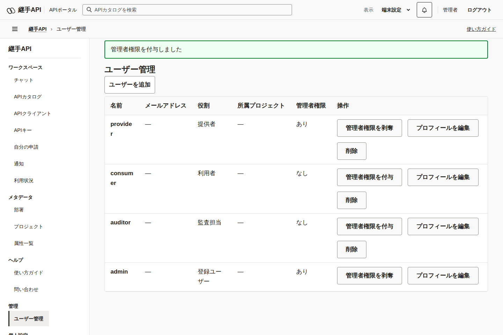

# 管理者は、管理者の担当者が変わったとき、利用者の管理者権限を変更できる

判定　合格

対象コミット　`bd04303ea2ed84cc024bfad2a8ef6bb82c0cd224`

[検証した要件と変更履歴](https://github.com/tsuji-tomonori/tsugite-api/blob/bd04303ea2ed84cc024bfad2a8ef6bb82c0cd224/docs/requirements/items/%E7%AE%A1%E7%90%86%E8%80%85%E3%81%AF%E3%80%81%E7%AE%A1%E7%90%86%E8%80%85%E3%81%AE%E6%8B%85%E5%BD%93%E8%80%85%E3%81%8C%E5%A4%89%E3%82%8F%E3%81%A3%E3%81%9F%E3%81%A8%E3%81%8D%E3%80%81%E5%88%A9%E7%94%A8%E8%80%85%E3%81%AE%E7%AE%A1%E7%90%86%E8%80%85%E6%A8%A9%E9%99%90%E3%82%92%E5%A4%89%E6%9B%B4%E3%81%A7%E3%81%8D%E3%82%8B.md)

## 実行したテストと証跡

- 成功　管理者が交代しても同じログインで権限が切り替わり、最後の一人は残る。（形式仕様の操作と期待状態を照合する。）（0.546 秒）　`packages/backend/tests/test_quint_administrators.py::test_admin_role_handover[administrators.handoverTest]`
- 成功　既存の管理者を全ページから引き継ぎ、同じメールでも識別子が異なる利用者には付与しない。（0.126 秒）　`packages/backend/tests/test_required_member_directory.py::test_external_admin_handover`
- 成功　ユーザー管理で別の管理者を追加し、権限の表示を確認してから剥奪できる。（5.060 秒）　`tests/e2e/browser/test_admin_roles.py::test_manage_admin_role`
  - 

[テスト実行記録（JUnit XML）](%E7%AE%A1%E7%90%86%E8%80%85%E3%81%AF%E3%80%81%E7%AE%A1%E7%90%86%E8%80%85%E3%81%AE%E6%8B%85%E5%BD%93%E8%80%85%E3%81%8C%E5%A4%89%E3%82%8F%E3%81%A3%E3%81%9F%E3%81%A8%E3%81%8D%E3%80%81%E5%88%A9%E7%94%A8%E8%80%85%E3%81%AE%E7%AE%A1%E7%90%86%E8%80%85%E6%A8%A9%E9%99%90%E3%82%92%E5%A4%89%E6%9B%B4%E3%81%A7%E3%81%8D%E3%82%8B.xml)
