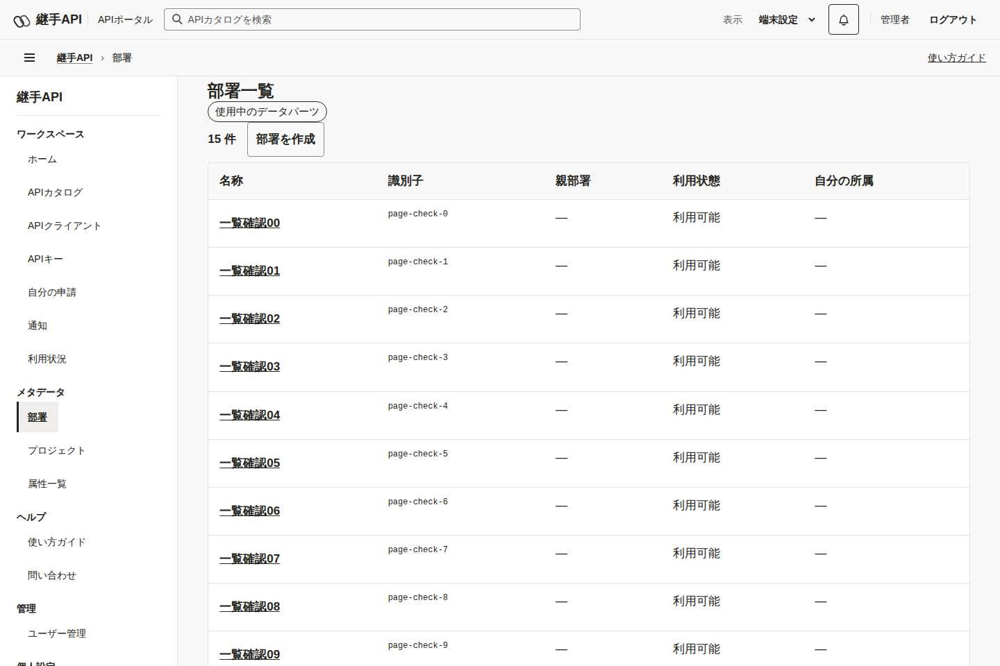

# 管理者は、部署やプロジェクトを管理するとき、一覧から対象の所属と設定を変更できる

判定　合格

対象コミット　`a8ce7bc1f7c63cce6c1b5f352626ae1b791f7a85`

## 実行したテストと証跡

- 成功　管理者が組織階層と兼務を設定し、リーダーがキー・利用状況・停止と再開を操作する（16.910 秒）　`tests/e2e/browser/test_workspace_console.py::test_workspace_key_console`
  - 

[テスト実行記録（JUnit XML）](%E7%AE%A1%E7%90%86%E8%80%85%E3%81%AF%E3%80%81%E9%83%A8%E7%BD%B2%E3%82%84%E3%83%97%E3%83%AD%E3%82%B8%E3%82%A7%E3%82%AF%E3%83%88%E3%82%92%E7%AE%A1%E7%90%86%E3%81%99%E3%82%8B%E3%81%A8%E3%81%8D%E3%80%81%E4%B8%80%E8%A6%A7%E3%81%8B%E3%82%89%E5%AF%BE%E8%B1%A1%E3%81%AE%E6%89%80%E5%B1%9E%E3%81%A8%E8%A8%AD%E5%AE%9A%E3%82%92%E5%A4%89%E6%9B%B4%E3%81%A7%E3%81%8D%E3%82%8B.xml)
