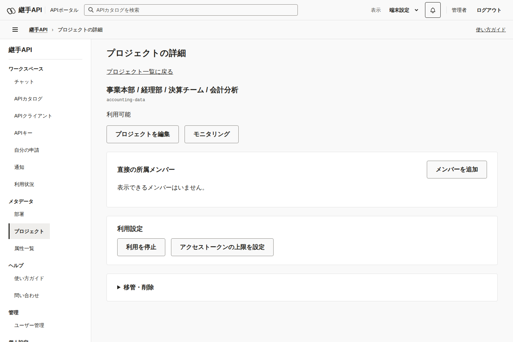

# 管理者は、部署を編成するとき、所属を設定できる

判定　合格

対象コミット　`9919f32a7df54974bb16798cc94c6a6111468218`

[検証した要件と変更履歴](https://github.com/tsuji-tomonori/tsugite-api/blob/9919f32a7df54974bb16798cc94c6a6111468218/docs/requirements/items/%E7%AE%A1%E7%90%86%E8%80%85%E3%81%AF%E3%80%81%E9%83%A8%E7%BD%B2%E3%82%92%E7%B7%A8%E6%88%90%E3%81%99%E3%82%8B%E3%81%A8%E3%81%8D%E3%80%81%E6%89%80%E5%B1%9E%E3%82%92%E8%A8%AD%E5%AE%9A%E3%81%A7%E3%81%8D%E3%82%8B.md)

## 実行したテストと証跡

- 成功　管理者が組織階層と兼務を設定し、リーダーがキー・利用状況・停止と再開を操作する（11.360 秒）　`tests/e2e/browser/test_workspace_console.py::test_workspace_key_console`
  - 
- 成功　一般利用者の所属付与、管理権限の変更、解除を本人の一覧から照合する。（形式仕様の操作と期待状態を照合する。）（0.139 秒）　`packages/backend/tests/test_quint_governance.py::test_membership_history[membership.membershipTest]`
- 成功　上位部署とプロジェクトを兼務してから片方を外しても、残る所属の役職と管理権限を保持する。（0.651 秒）　`packages/backend/tests/test_required_workspace.py::test_direct_and_concurrent_memberships`

[テスト実行記録（JUnit XML）](%E7%AE%A1%E7%90%86%E8%80%85%E3%81%AF%E3%80%81%E9%83%A8%E7%BD%B2%E3%82%92%E7%B7%A8%E6%88%90%E3%81%99%E3%82%8B%E3%81%A8%E3%81%8D%E3%80%81%E6%89%80%E5%B1%9E%E3%82%92%E8%A8%AD%E5%AE%9A%E3%81%A7%E3%81%8D%E3%82%8B.xml)
